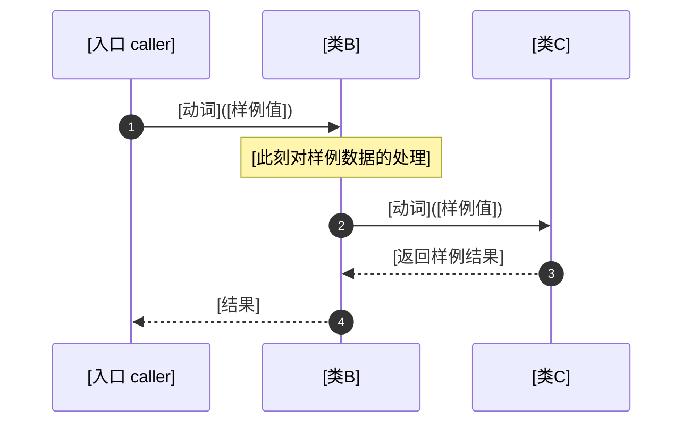

# CodeLearn 答案模板

复制下面的骨架生成 `mylearn/YYYYMMDD-HHmmss-<slug>.md`。方括号是提示，正式输出时替换掉。

---

# [主题] 学习笔记

> **问题**：[用户原问题]
> **生成时间**：[YYYY-MM-DD HH:mm]
> **涉及代码**：`path/a.cpp:120`、`path/b.hpp:45` …

## 1. 一句话结论

[用 1~3 句说清「它到底怎么工作」，先给结论。]

## 2. 样例数据（贯穿全文的主线）

> 后面所有图都用这一份数据，不再换。

```sql
-- 输入：一个最小可跑的例子
[例如 CREATE TABLE t(a INT, b INT); INSERT ...; SELECT ...;]
```

| 输入 | 期望输出 / 关键中间态 |
|------|----------------------|
| ... | ... |

用到的具体值：`[a=1, b=2, ...]`。

## 3. 核心数据结构 / 核心数据对象

| 对象 | 职责 | 关键字段 | 定义位置 |
|------|------|----------|----------|
| `[ClassName]` | [它负责什么] | `[field: type]` | `path:line` |
| `[ClassName2]` | ... | ... | ... |

```mermaid
classDiagram
    class [ClassName] {
        +[type] [field]
        +[method]()
    }
    class [ClassName2] {
        +[type] [field]
    }
    [ClassName] --> [ClassName2] : [关系说明]
```

## 4. 执行流程（时序图）

[说明这条链路对应样例数据的哪一步。]



## 5. 关键代码走读

沿样例数据逐段对照源码：

1. `path/a.cpp:120` — [对样例数据做了什么]
2. `path/b.hpp:45` — [对样例数据做了什么]
3. ...

## 6. 小结 / 延伸（可选）

- [易错点、设计意图、上下游衔接]

---

# mylearn/README.md 索引格式

新建文件后，在 `mylearn/README.md` 的「目录」里追加：

```markdown
- [YYYY-MM-DD HH:mm] [一句话主题](YYYYMMDD-HHmmss-slug.md)
```

`README.md` 初始内容：

```markdown
# mylearn — 代码学习笔记

学习现有代码的图文问答归档。**只读源码，不修改现有逻辑**，方便与主仓库同步。

## 目录

- [YYYY-MM-DD HH:mm] [示例主题](YYYYMMDD-HHmmss-slug.md)
```
