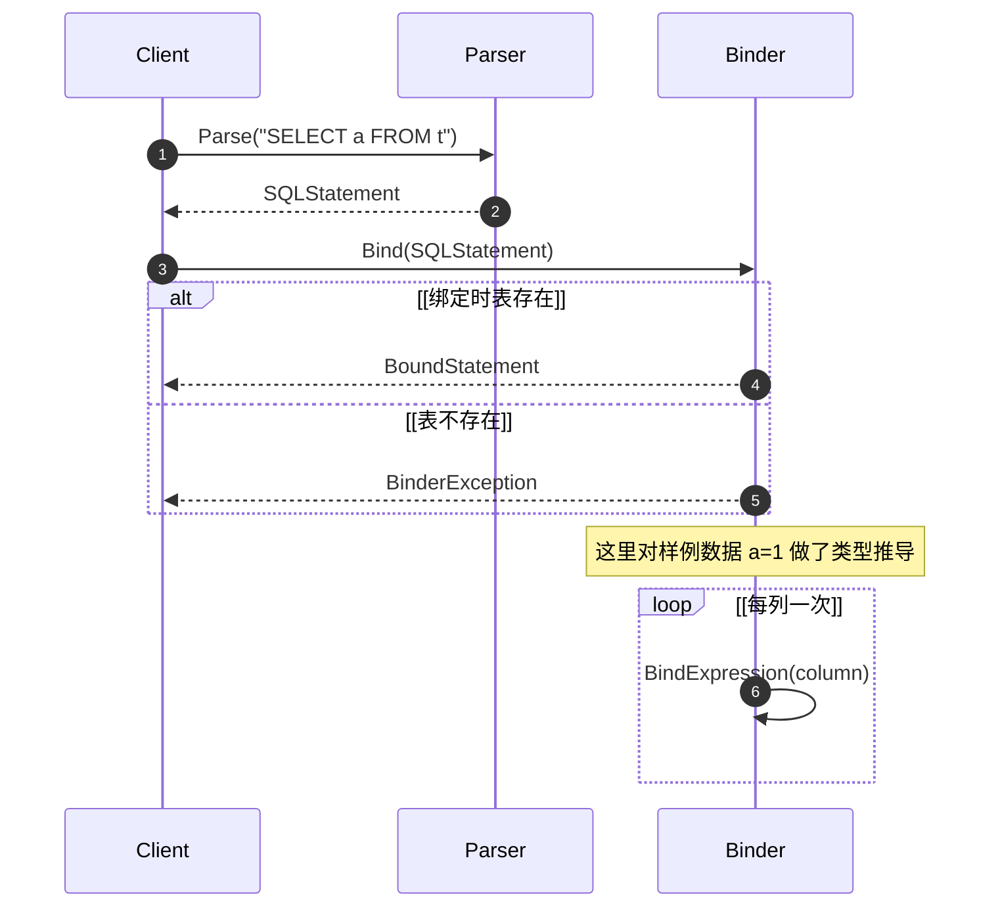
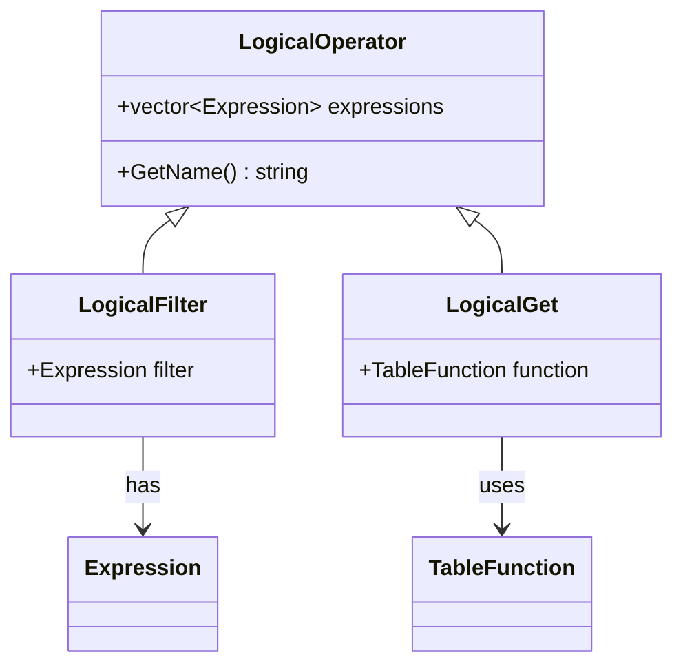
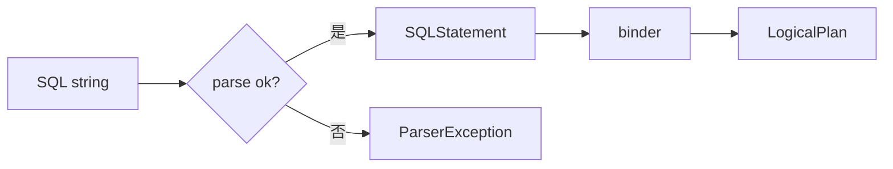

# Mermaid 速查（CodeLearn 专用）

只列本项目最常用的三种图。原则：**图里带真实样例值**，不要占位符。

## 时序图 sequenceDiagram（讲流程必用）

- `->>` 实线调用；`-->>` 返回；`-)` 异步；`--x` 失败。
- `autonumber` 自动编号步骤。
- `alt / else / end` 分支；`opt / end` 可选；`loop / end` 循环；`Note over X` 注释。
- 参与者建议 `as` 起短别名，控制宽度。

## 类图 classDiagram（讲数据结构必用）

- `<|--` 继承；`*--` 组合；`o--` 聚合；`-->` 关联；`..>` 依赖。
- 字段/方法写实际名字与类型，与源码对应。

## 流程图 flowchart（讲分支/数据变换时用）

- `LR / TD` 控制方向；`{}` 判定；方括号是节点文字。
- 节点文字写具体对象/样例值，不要空泛。

## 通用建议

- 一张图别塞太多节点，看不清就拆图。
- 图前一句话说「这张图对应样例数据的哪一步」。
- 图后配文字，图和文字要能互相印证。
